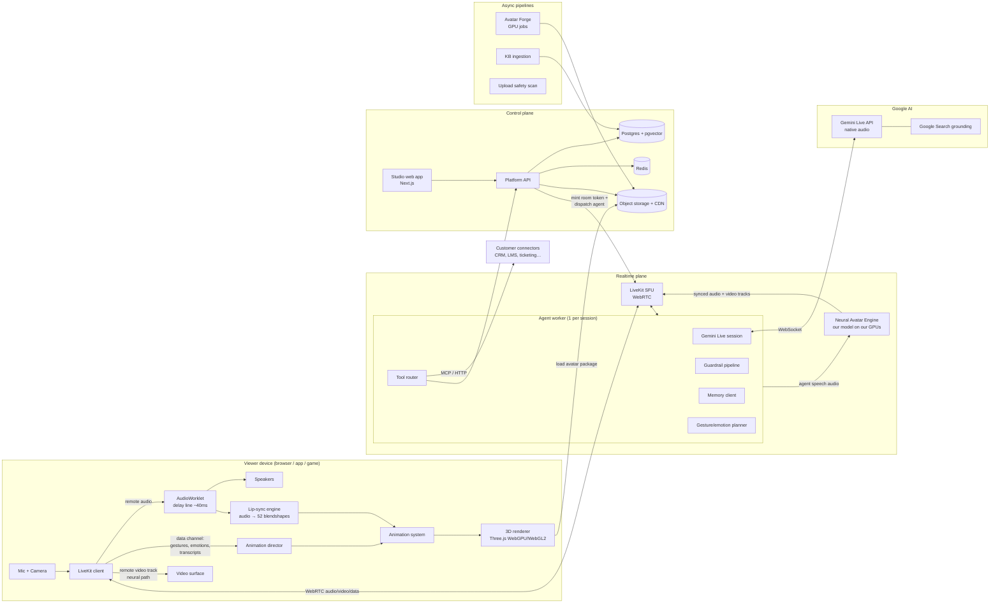
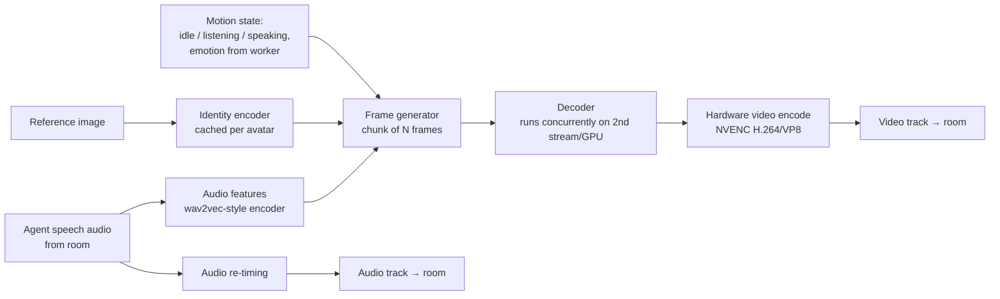

# MetaAvatar — System Architecture

> Working name. "Meta Avatar(s)" is also a product name used by Meta Platforms, so pick a final brand
> before public launch (see Open Decisions in the [Implementation Guide](./IMPLEMENTATION_GUIDE.md)).

## 1. What we are building

A platform for **real-time conversational AI personas that have a body**. A user speaks (mic) and
optionally shows things (camera). The AI listens, understands, and answers through a **live, fully
animated 3D avatar** whose lips, face, eyes, head and body move with the speech.

### Build-it-ourselves principle
**No paid avatar, rendering, voice or 3D-generation platforms.** Free tiers and free tools are fine while we build demos (see §12.0); budget is one MacBook M4 and at most $20/month. Every renderer, model-serving stack
and pipeline is our own code, running on open-source software and open-weight models (commercial-use
licenses only) on infrastructure we control. Infra pieces we adopt are self-hosted open source
(LiveKit server, Postgres, Redis, MinIO). **The one external service is the Gemini Live API**, which
the brief names as the brain; it sits behind the `RealtimeModel` interface so it could later be
replaced by a self-hosted speech-to-speech model.

### Benchmark reference: Runway Characters
The brief maps almost one-to-one onto [Runway Characters](https://runway.com/product/characters)
("real-time conversational video agents, made from a single image"): same verticals, same feature
list (vision, custom voice, tool calling, knowledge base, embeddable widget, meeting integration), and
the **37 ms** figure is Runway's *effective model time per frame* for their real-time video model
(GWM-1, 24 fps HD). We use it **only as the quality and performance bar to match with our own
stack** — we do not use their product. Their published numbers (May 2026 engineering post):

| Runway metric | Value | Our target |
|---|---|---|
| Model time per frame | 37 ms (24 fps, 720p+) | ≤ 37 ms/frame on the neural path; ≤ 33 ms/frame (30 fps) on the 3D path |
| Server turnaround, end of speech → first frame | 1.75 s (1185 ms voice agent + 567 ms video) | **≤ 1.2 s** (Gemini native audio replaces their STT→LLM→TTS cascade, which is their biggest latency cost) |
| Network | ~200 ms each way | Same (WebRTC via LiveKit) |
| Visual styles | Photoreal, cartoon, creature, mascot from **one image** | Same on the neural path |
| Body | Face, lips, head motion | **Full body**: 3D path natively; neural path upper body over time |
| Their price | 2 credits / 6 s ≈ $0.20 per active minute | Our GPU cost per minute must land below this (§11) |

**"Not a video" means not pre-recorded.** Every frame is generated or rendered live in response to
the conversation, never a looped or canned clip. Two in-house rendering paths meet that bar (§6):
**neural video** generated live by our own model on our GPU servers (highest realism, any style from
one image), and a **real-time 3D** avatar rendered on the viewer's device (full body, game-engine
ready, near-zero marginal cost). The platform is renderer-agnostic, so each agent picks one.

**Where we aim to beat the reference**: faster replies (speech-to-speech Gemini instead of a voice
cascade), full-body 3D option, long-term memory, MCP connectors, Google Search grounding, a stricter
safety and child-protection layer, and a fully owned stack with no vendor dependency for rendering.

### Requirements from the brief, made measurable

| # | Requirement | How the architecture answers it | Target |
|---|---|---|---|
| R1 | Human-like appearance, realism, moving full-body animation, not a video | Pluggable renderer: **neural video** (live-generated frames, photoreal, any style) or **real-time 3D** on the client (layered full-body animation + facial blendshapes) | Neural: 24–30 fps HD · 3D: 60 fps desktop, **≥ 30 fps floor** on mid-range phones |
| R2 | Integrated with Gemini Live | A per-session agent worker holds a Gemini Live session (speech-to-speech, native audio) | Voice-to-voice ≤ 1.0 s p50 |
| R3 | Options: voice, appearance, names, integrations, tools, grounding, search | "Agent" (persona) is a configuration object in the control plane; the worker builds the Gemini session from it | — |
| F1 | Agents made from image / character references | Neural path: the single reference image *is* the avatar (no 3D build). 3D path: **Avatar Forge** pipeline, image → rigged Avatar Package | Neural: instant · 3D: async job, minutes |
| F2 | Education, customer support, meeting displays, gaming & entertainment — all real-time | One realtime core; per-vertical templates + delivery surfaces (web embed, meeting bot, game-engine SDK) | — |
| F3 | Performance 37 ms, ≥ 30 fps | **37 ms = time to produce one frame** (Runway's definition): neural path ≤ 37 ms model time/frame; 3D path ≤ 33 ms render time/frame, plus lips within 37 ms of the audio. *Not* the reply time, which is bounded by the model (see §4). | ≤ 37 ms/frame, ≥ 24–30 fps |
| F4 | Vision (camera + screen share), voice, custom voice, tool calling, knowledge base, embeddable widget, memory, connectors, meetings | Camera/screen frames → Gemini; prebuilt Gemini voices or designed/cloned voices via a TTS stage; tools (UI actions + backend RPCs + MCP); RAG tool; `<meta-avatar>` widget + React SDK; memory service; Zoom/Meet/Teams bot | — |
| F5 | Guardrails, child safety, legal compliance | Five-layer safety pipeline, audience profiles (incl. Kids mode), consent & likeness controls, AI disclosure, data governance | — |

---

## 2. High-level architecture



### The four planes

1. **Client plane** — the *Avatar Runtime* (TypeScript). Captures mic/camera/screen, plays the agent's
   voice, and either shows the neural video track or renders + animates the 3D avatar locally. Ships
   as a React SDK, a `<meta-avatar>` web component (one script tag), an iframe embed, and later
   Unity/Unreal SDKs.
2. **Realtime plane** — **LiveKit** (WebRTC SFU) plus **agent workers** (Python, LiveKit Agents). Each
   live conversation is one room with one agent worker that bridges audio/video to Gemini Live and runs
   tools, guardrails and memory. On the neural path, our **Neural Avatar Engine** (§6.2) joins the
   same room: it takes the agent's speech audio and publishes lip-synced video (+ the audio, in sync).
   LiveKit server and LiveKit Agents are Apache-2.0 open source and self-hosted.
3. **Control plane** — Studio (dashboard/persona builder/playground) and the Platform API: tenants,
   agents, avatars, knowledge bases, connectors, embed keys, session tokens, usage and billing.
4. **Async pipelines** — Avatar Forge (image → avatar), knowledge-base ingestion, upload safety scanning.

---

## 3. Key design decisions (and why)

### D1. Renderer is a pluggable stage: neural video *or* real-time 3D
- Runway-level realism from a single image (photoreal, cartoon, creature, mascot) is only reachable
  today with a **real-time generative video model** on server GPUs. Full-body motion, game-engine
  embedding and near-zero per-minute cost are only reachable with **client-side 3D**.
- Both consume the same thing — the agent's speech audio plus emotion/gesture events — so the
  renderer sits behind one interface (`AvatarRenderer`) and is chosen per agent. Everything else
  (brain, tools, memory, safety, Studio, widget) is shared and is where the platform's value lives.
- Both renderers are built in-house. The 3D path is engineering work and ships first; the neural
  path is model work that starts from open-weight research models and is staged (§6.2–6.3) so a
  usable version exists early and quality climbs toward the Runway bar.

### D2. WebRTC via LiveKit between client and agent; Gemini Live behind the agent
- Client → Gemini direct (with ephemeral tokens) is the lowest-latency path, but it puts the model
  session on an untrusted device, which makes **guardrails, child safety, tool execution, memory,
  audit logs and billing unenforceable**. For a production platform that is a non-starter.
- WebRTC (UDP, Opus, jitter buffers, echo cancellation) is far more robust than raw WebSockets on
  mobile networks. We self-host the open-source LiveKit server (no LiveKit Cloud), and the open-source
  LiveKit Agents framework has a Google/Gemini realtime plugin, interruption handling and video input.
- Cost of the extra hop: ~20–60 ms. Acceptable against a ~600–1000 ms model turn.
- Escape hatch: the worker talks to Gemini through our own thin `RealtimeModel` interface, so we can
  swap providers (e.g. a different speech-to-speech model) per agent.

### D3. Lip-sync is derived on the client from the exact audio being played
- Gemini native-audio does not return phoneme/viseme timings.
- The client routes the agent's audio through an **AudioWorklet delay line** (~40 ms). The lip-sync
  model sees the samples *before* they reach the speakers, so the mouth is always in sync by
  construction — no clock alignment between server and client needed. This is how we hit the
  **≤ 37 ms audio-to-mouth** target.
- Engines (pluggable, same output = ARKit 52 blendshape weights):
  - **L1 – Spectral visemes** (v1): FFT/formant features → 15 visemes → blendshapes. Tiny, runs anywhere.
  - **L2 – Neural audio→blendshape on device** (v2): small model in ONNX Runtime Web (WebGPU/WASM)
    producing full-face ARKit weights incl. expression.
  - **L3 – Server-side audio→face model** (optional): our own model, or NVIDIA's open-weight
    Audio2Face-3D networks run in our own inference server (not NVIDIA's NIM container), streaming
    ARKit weights with audio timestamps over the data channel. Model weights are under the NVIDIA Open
    Model License, so review it before use.

### D4. Body animation = layered system, driven by three signals
| Layer | Driven by | Examples |
|---|---|---|
| Base | State machine (`idle`, `listening`, `thinking`, `speaking`) | breathing idle, attentive lean while listening |
| Prosody gestures | Audio energy/pitch of agent speech (client-side) | beat gestures, head nods on stressed syllables |
| Semantic gestures | Output transcript keywords + emotion tags (worker → data channel) | wave on greeting, "counting" hands, shrug |
| Intentional actions | Gemini tool call `express(emotion, gesture, intensity)` (non-blocking) | point at screen, celebrate, look at object |
| Procedural | Always-on | blinks, saccades, gaze at user (face tracking from camera), look-at, foot IK |
| Face | Lip-sync engine + emotion blend | visemes + smile/frown/brow |

Gestures don't need frame-accurate sync (±150 ms reads as natural); lips do, hence D3.

### D5. One canonical avatar format: the **Avatar Package**
- `avatar.glb`: glTF 2.0 with a **humanoid skeleton using VRM 1.0 bone names**, **ARKit 52
  blendshapes** (+ optional 15 Oculus visemes), PBR materials, 2–3 LODs, meshopt + KTX2 compression.
- `manifest.json`: id, version, skeleton map, blendshape map, default voice, animation set, bounds,
  realism tier, provenance + consent record id.
- All animation clips are authored once on the canonical skeleton and **retargeted at load time**, so
  every avatar — preset, uploaded, or Forge-generated — gets the full gesture library for free.

### D6. Agents are configuration, workers are generic
An **Agent** (persona) is data: name, avatar, voice, language, system instructions, audience profile,
tools, knowledge bases, connectors, memory policy, grounding flags. A generic worker loads it at
session start. No per-customer code deploys.

---

## 4. Anatomy of one conversational turn

```mermaid
sequenceDiagram
  autonumber
  participant U as User (browser)
  participant RT as Avatar Runtime
  participant SFU as LiveKit SFU
  participant W as Agent worker
  participant G as Gemini Live
  participant T as Tools / KB / MCP

  U->>RT: speaks
  RT->>SFU: Opus audio (+1 fps camera frames if vision on)
  SFU->>W: audio frames
  W->>G: realtime input (16 kHz PCM / JPEG frames)
  RT-->>RT: avatar state = listening (lean in, nods)
  G-->>W: input transcription (streamed)
  W-->>W: input guardrail check (async)
  G-->>W: end of user turn detected
  RT-->>RT: state = thinking (micro-gesture)
  opt tool needed
    G->>W: functionCall(search_kb / connector)
    W->>T: execute (policy-checked)
    T-->>W: result
    W->>G: functionResponse
  end
  G-->>W: audio chunks (24 kHz) + output transcription
  W-->>W: output guardrail (streamed transcript)
  W->>SFU: agent audio track + data msgs (emotion, gesture, transcript)
  SFU->>RT: audio + data
  RT-->>RT: delay line → lip-sync → blendshapes; gestures; render 60 fps
  RT->>U: avatar speaks
  U->>RT: interrupts (barge-in)
  G-->>W: interrupted
  W->>RT: flush event
  RT-->>RT: stop audio, close mouth, return to listening (< 100 ms)
```

### Latency budget (p50 targets)

| Stage | 3D path | Neural path |
|---|---|---|
| Mic capture + Opus encode | 20 ms | 20 ms |
| Client → SFU → worker | 20–60 ms | 20–60 ms |
| End-of-turn detection (Gemini VAD, tuned) | 200–400 ms | 200–400 ms |
| Gemini time-to-first-audio | 300–600 ms | 300–600 ms |
| Avatar video pipeline (first frame) | — | ~300–600 ms target (Runway: 567 ms) |
| Worker/renderer → SFU → client + jitter buffer | 40–100 ms | 40–100 ms |
| **Voice-to-voice total** | **≈ 0.6–1.1 s** | **≈ 1.1–1.7 s** |
| Per-frame cost | ≤ 16 ms render (60 fps), ceiling 33 ms | ≤ 37 ms model time (24 fps+) |
| Lips vs. audio | ≤ 37 ms (AudioWorklet delay line) | In sync by construction (renderer publishes both tracks) |

For comparison, Runway reports 1.75 s server-side plus ~0.4 s network round trip. Our main edge is the
voice stage: Gemini native audio is speech-to-speech, versus their ~1.2 s voice-agent cascade.

We measure every stage per turn (§10) and alert on regressions.

---

## 5. Component details

### 5.1 Avatar Runtime (`packages/avatar-runtime`)
- **Renderer**: Three.js with `WebGPURenderer` (auto-fallback to WebGL2). PBR + subsurface-ish skin
  shader, hair cards, eye refraction, soft shadows, tone mapping. Quality presets auto-selected from a
  GPU benchmark at startup; dynamic resolution scaling to hold ≥ 30 fps.
- **Animation**: `AnimationMixer` layers (base, additive gestures, upper-body masks), procedural
  modules (blink, saccade, look-at, breathing, IK), face compositor (lip-sync ⊕ emotion ⊕ blink with
  per-region priorities).
- **Audio**: AudioWorklet pipeline: remote track → delay line → (speakers, lip-sync analyser);
  mic capture with echo cancellation/noise suppression via WebRTC constraints.
- **Transport**: LiveKit JS client; typed event bus over the data channel
  (`agent.state`, `agent.emotion`, `agent.gesture`, `transcript.partial/final`, `ui.card`,
  `session.warning`).
- **Surfaces**: React component, `<meta-avatar agent="…" key="pk_…">` web component (Shadow DOM,
  ~1 script tag), iframe for strict CSP sites. Captions, push-to-talk, mute, text input fallback, and
  an always-visible "AI" disclosure badge.
- Off-main-thread: rendering in an `OffscreenCanvas` worker where supported.

### 5.2 Agent worker (`services/agent-worker`, Python)
- LiveKit Agents `AgentSession` + Google realtime plugin (or direct `google-genai` Live client behind
  our `RealtimeModel` interface).
- **Session bootstrap**: fetch Agent config by id (signed metadata on dispatch) → compose system
  instructions = *platform safety preamble* (non-removable) + *audience profile rules* + tenant persona
  + memory summary → declare tools → open Gemini session with voice, language, VAD, transcription,
  **context-window compression** and **session resumption** enabled.
- **Voices**: (a) Gemini prebuilt voices — lowest latency, speech-to-speech; (b) **custom voices** —
  designed from a text prompt or cloned from a sample, produced by **our own self-hosted TTS service**
  (`services/voice`, open-weight TTS models with commercial-use licences, streaming on GPU). Gemini Live
  runs with text output and our TTS speaks it ("half-cascade", ~+200–400 ms). Cloning requires a
  recorded consent statement from the voice owner.
- **Long sessions**: Gemini Live connections are time-limited (audio-only ~15 min, audio+video ~2 min
  without compression; connections recycled roughly every ~10 min). The worker handles `goAway`,
  reconnects with the resumption handle, and the user never notices.
- **Tool router**: built-ins (`search_knowledge_base`, `remember`, `recall`, `express`, `show_card`,
  `end_session`, `handoff_to_human`), Google Search grounding, tenant HTTP tools (webhooks with
  HMAC signing), and **MCP connectors** (OAuth-scoped per tenant). Every call passes the policy
  engine: allowlist, JSON-schema arg validation, rate limits, and *confirm-before-act* for
  side-effecting tools.
- **Guardrail pipeline** (§8), **memory client**, **gesture/emotion planner**, transcript + metrics
  emission.
- Scaling: stateless; one process hosts N sessions (CPU-bound on audio resampling only). Autoscale on
  active-session count.

### 5.3 Platform API (`services/api`, TypeScript)
- Hono on Node, Postgres via Drizzle, Zod schemas shared with the frontend and code-generated to
  Pydantic for the worker.
- Endpoints: auth/orgs/members, agents CRUD + versions, avatars, voices catalog, KBs + documents,
  connectors (OAuth), embed keys (allowed origins, rate limits), `POST /sessions` (validates embed
  key/origin, end-user identity, quota → returns LiveKit token + dispatches worker), webhooks, usage.
- Public surface (embed) and private surface (studio) separated by auth type and rate limits.

### 5.4 Studio (`apps/studio`, Next.js)
- Persona builder: name, avatar picker / Forge upload, voice preview, language, instructions,
  audience profile, tools/connectors toggles, KB attach, memory policy, guardrail level.
- **Live playground** with the real runtime + latency HUD (TTFA, A/V offset, fps).
- Conversation logs (retention-aware), safety events review queue, analytics, embed code generator,
  billing.

### 5.5 Avatar Forge (`services/avatar-forge`, Python, GPU) — 3D path only
The neural path needs no Forge: the uploaded image (after consent + safety scan) is the avatar.
For the 3D path, Forge is an async job pipeline (queue → our GPU workers) running self-hosted
open-weight models behind a **model abstraction**, because this tech moves monthly. No paid
image-to-3D APIs.

```mermaid
flowchart LR
  UP[Upload image(s)] --> CON[Consent + rights attestation]
  CON --> SCAN[Safety scan:<br/>CSAM hash match, minor detection,<br/>public-figure likeness check]
  SCAN -->|photo of a person| P1[Face reconstruction<br/>head mesh / Gaussian head]
  SCAN -->|character art| P2[Image → 3D model]
  P1 --> BODY[Fit to canonical body template]
  P2 --> RIG[Auto-rig to canonical skeleton]
  BODY --> RIG
  RIG --> BS[ARKit blendshape transfer<br/>from template]
  BS --> OPT[Optimize: retopo/decimate,<br/>LODs, KTX2, meshopt]
  OPT --> QA[Auto QA renders +<br/>animation smoke test]
  QA --> PUB[Publish Avatar Package → CDN]
```

- Policy: **no realistic avatars of minors**, no public figures without verified rights, only people
  who consented (self-capture liveness check for "make me an avatar" flows). Consent records are
  stored and linked from the package manifest.
- Watch licensing of building blocks: parametric body models like SMPL-X need a commercial licence,
  and some open image-to-3D model licences exclude certain territories or uses. Where a licence
  doesn't fit, build our own (e.g. our own canonical body template and auto-rigger).

### 5.6 Knowledge, grounding, memory
- **KB ingestion**: upload/URL/connector sync → parse → chunk → embed (Gemini embeddings) →
  `pgvector`. Exposed to Gemini as the `search_knowledge_base` tool; results come back with source ids
  so the avatar can cite and Studio can show sources.
- **Grounding**: Google Search tool per agent (toggle); answers carry search metadata to display.
- **Memory** (opt-in per agent, **off by default for Kids mode**): per end-user facts + episode
  summaries with embeddings; summary injected at session start, `recall` tool for details, user-visible
  "what you remember about me" + delete.

---

## 6. Rendering paths

### 6.1 Comparison

| | **Neural video** (our Neural Avatar Engine) | **Real-time 3D** (our client runtime) |
|---|---|---|
| Input to create an avatar | One image, any style | Avatar Package (preset, or built by Forge from an image) |
| Realism | Highest: photoreal skin, hair, lighting, natural micro-expressions | High-quality stylized-realistic; photoreal is hard (uncanny valley) |
| Body | Face, lips, head (upper body in later model stages) | **Full body**, gestures, IK, can walk/point at things |
| Interactivity | Fixed camera framing, no scene interaction | Gaze tracking, camera moves, AR, game-state interaction |
| Where frames are made | Our GPU servers, streamed as WebRTC video | Viewer's device |
| Added latency | +~0.3–0.6 s video pipeline (Runway: 567 ms) | ~0 (40 ms delay line, hidden) |
| Marginal cost | GPU time per active minute (our own GPUs) | ~Zero (CDN bytes) |
| Build effort | Model research + training + inference optimisation | Graphics + animation engineering |
| Game engines / meetings | Video into meetings works well; poor fit for games | Native in Unity/Unreal; video for meetings via virtual camera |
| Best for | Support, sales/training simulations, education tutors, brand mascots, meetings | Gaming & entertainment, kiosks, high-volume/low-cost, full-body coaching |

### 6.2 Neural Avatar Engine — the service (`services/neural-engine`, Python + CUDA)
Our own inference server. It joins the LiveKit room as a participant, subscribes to the agent's
speech audio, and publishes a video track plus the same audio re-timed so lips and sound stay in sync.



- **Always alive**: when the agent is silent, the generator keeps producing idle/listening motion
  (blinks, small head moves, reactions), so the character never freezes.
- **Barge-in**: on `agent.flush`, drop queued audio and frames and blend back to listening in < 200 ms.
- **Identity cache**: the reference image is encoded once per avatar and stored, so a new session
  starts without re-processing.
- **GPU scheduler**: bin-packs sessions onto GPUs, does admission control, and falls back to the 3D
  path when there's no capacity, so a session never fails because GPUs are busy.
- Per-session long-context handling (KV-cache eviction/compression) keeps identity stable over long
  conversations without memory growing.

### 6.3 Neural model roadmap (built on open weights, then our own)
Runway's write-up sets the bar: 37 ms of model time per frame at 24 fps, with frames generated
autoregressively in chunks (4 frames per step → one step every 167 ms) and the denoiser and decoder
overlapped on separate GPUs, so cost ≈ max(denoise, decode) rather than the sum. Plus tensor-parallel
sharding, CUDA Graphs and fused Triton kernels. We reach it in stages, each usable in production:

| Stage | Approach | Hardware per session | Quality | Gate to ship |
|---|---|---|---|---|
| **N1 — Lite** | 2D portrait animation: audio→motion model drives a warping/keypoint animator, plus a mouth-region generator | Fraction of one GPU (several sessions per GPU) | Good lips and head motion on realistic faces; weaker on cartoons and creatures | ≥ 25 fps 512–720p, lip-sync score at or above open baselines |
| **N2 — Pro** | Streaming autoregressive video diffusion conditioned on audio + reference image, starting from Apache-2.0 open weights (e.g. Alibaba-Quark **Live Avatar**: 14B, reports 45 fps on 5 × H100), **distilled** into a smaller few-step student (self-forcing-style distillation) | Target 1–2 data-centre GPUs | Near-Runway: any style from one image, expressive face | ≤ 37 ms/frame at 720p, 1-hour identity stability |
| **N3 — Own foundation model** | Our model trained on licensed + consented conversational video; adds upper body and hands, emotion control | Same as N2 or less | Beyond reference (body, gestures) | Beats N2 on human-preference tests |

- **Licences**: only models whose code *and* weights allow commercial use. Several popular avatar
  repos depend on face-detection or landmark models with non-commercial licences, so we swap those
  for our own or permissively licensed ones. Every model goes in a licence registry with its source.
- **Training data** is the hardest non-technical part: we need consented, licensed talking-head video
  (and later body video). Plan for data collection with release forms, plus licensed datasets.
- **Hardware**: N1 can run on single cloud or on-prem GPUs. N2 needs data-centre GPUs (H100-class) for
  distillation training and serving. GPU cost per active minute is tracked from day one (§11).

### 6.3b Laptop-friendly neural option: one-shot Gaussian head (LAM)
Before we can afford server GPUs, the photoreal-from-one-photo feature comes from **LAM** (open
source, SIGGRAPH 2025): one image → an animatable 3D Gaussian-splat head in a single forward pass,
rendered in real time on the viewer's device (WebGL SDK; 110+ fps reported on a phone) and driven
from audio by its Audio2Expression model. It's a client-side renderer, so per-minute cost is zero and
it fits our `AvatarRenderer` interface next to the 3D path. Limits: head/bust only, no tongue,
avatar build needs a GPU for best speed (free Colab works), and the FLAME face model it relies on has
a research licence, so it needs a licence review before commercial use.

### 6.4 3D path quality tiers
| Tier | Representation | Where it runs | Status |
|---|---|---|---|
| **A — Real-time mesh** | Stylized-to-semi-realistic rigged GLB, ARKit face | Everywhere incl. mid-range phones, 60 fps | v1 |
| **B — Neural 3D** | 3D Gaussian-splat head (one-shot from photo) on a mesh body, ARKit-driven | WebGPU desktops / high-end phones | R&D |

---

## 7. Delivery surfaces per vertical (F2)

| Vertical | Surface | Extra pieces |
|---|---|---|
| Education | Web embed, LMS (LTI 1.3) | Lesson/KB templates, whiteboard cards via `show_card`, **Kids mode**, teacher dashboard |
| Customer support | Web embed / mobile SDK | Ticketing & CRM connectors, `handoff_to_human`, CSAT, PII redaction |
| Training simulations | Web embed | Role-play personas (sales coaching, interview prep, management training, onboarding), scoring rubric tool, post-session feedback report |
| Meeting displays | Meeting bot (Zoom/Meet/Teams) or kiosk display | Bot joins as a participant that sees and hears the room; neural path publishes its video track directly, 3D path renders headless into a virtual camera |
| Gaming & entertainment | Unity / Unreal SDK, web | Engine-native runtime consuming the same data-channel protocol + Avatar Package; NPC tool calls into game state |

---

## 8. Safety, child protection and compliance (F5)

### Five-layer guardrail pipeline
1. **Policy layer** — platform safety preamble prepended to every persona (tenants can't remove it);
   audience profiles (`general`, `teen`, `kids`) add stricter rules and disable risky features.
2. **Model layer** — Gemini safety settings at the strictest thresholds for `teen`/`kids`.
3. **Streaming moderation** — input and output transcriptions classified continuously by a fast text
   classifier; on violation the worker **interrupts playback**, plays a safe redirect, logs a
   `safety_event`, and can end the session. Self-harm / abuse disclosures trigger a scripted,
   resource-providing response and tenant escalation webhooks.
4. **Action layer** — tool allowlists, argument validation, confirm-before-act, per-session rate limits,
   no tool may exfiltrate transcripts to unapproved destinations.
5. **Asset layer** — upload scanning (CSAM hash matching, nudity, minors, public figures), likeness
   consent, provenance (C2PA) on exported media.

**Known limit of speech-to-speech models**: audio is generated before its transcript can be checked,
so layer 3 is *near*-real-time, not pre-emptive. For `kids` profile we offer **Strict mode**: Gemini
Live with text output → moderation → TTS ("half-cascade"). It adds ~300–500 ms but guarantees nothing
unmoderated is spoken.

### Child-safety specifics
- Tenant must declare audience; Kids mode: no long-term memory, no PII collection prompts, no
  open web search by default, no companion/romantic personas, session time limits, captions on.
- Parental-consent tooling (COPPA verifiable parental consent; GDPR-K / India DPDP verifiable
  consent for children) exposed as hooks; age assurance is the tenant's obligation, with our tooling.
- **Provider terms check (blocking item):** consumer-API terms for some model providers restrict apps
  directed at or likely to be used by under-18s. Kid-facing deployments should run on **Vertex AI**
  under a Google Cloud agreement after legal review — verify current terms before launch.

### Regulatory map (requires counsel — compliance is a program, not a feature)
| Area | What we build |
|---|---|
| EU AI Act Art. 50 (in force since 2 Aug 2026) | Non-removable "You're talking to an AI" badge + spoken disclosure; machine-readable marking of generated media; deepfake labelling for photoreal likeness avatars |
| GDPR / UK GDPR / India DPDP / CCPA | DPA, data residency (Vertex regions), configurable retention, DSAR export/delete, purpose limitation, sub-processor list |
| Biometrics (e.g. Illinois BIPA) | Written consent + retention schedule for face images used in Forge; no face templates kept after build |
| Recording consent | Mic/camera consent UI; transcripts/recordings off unless tenant enables with notice |
| Accessibility (WCAG 2.2 AA) | Captions, keyboard control, text-chat fallback, reduced-motion mode |
| Security | SOC 2 path: SSO, RBAC, audit logs, encryption at rest/in transit, secrets in KMS, pen-tests |

---

## 9. Data model (core)

```
organizations(id, name, plan, region, data_retention_days)
users(id, email) · memberships(org_id, user_id, role)
agents(id, org_id, name, renderer[neural|3d], avatar_id, voice_id, language, model, instructions, audience_profile,
       safety_level, memory_policy, grounding_search, version, published_at)
agent_tools(agent_id, kind[builtin|http|mcp], config, requires_confirmation)
avatars(id, org_id, renderer, source[preset|upload|forge], reference_image_url, identity_cache_url, tier, package_url, status, consent_record_id)
consent_records(id, subject_type, method, evidence_ref, created_at, expires_at)
knowledge_bases(id, org_id) · documents(id, kb_id, source, status) · chunks(id, doc_id, text, embedding vector)
connectors(id, org_id, kind, mcp_url, oauth_credentials_enc)
embed_keys(id, org_id, agent_id, allowed_origins[], rate_limit)
end_users(id, org_id, external_ref_hash, age_band)          -- pseudonymous
memories(id, end_user_id, agent_id, fact, embedding, created_at)
sessions(id, org_id, agent_id, end_user_id, started_at, ended_at, minutes, metrics jsonb)
transcripts(session_id, seq, role, text, ts)                 -- retention-limited
safety_events(id, session_id, layer, category, severity, action, ts)
usage_records(org_id, period, audio_minutes, video_minutes, tool_calls)
```

---

## 10. Observability & SLOs
- OpenTelemetry traces across API → worker → Gemini → tools; one trace per turn.
- Per-turn metrics: end-of-speech→first-audio, tool latency, interruptions, A/V offset (client beacon),
  fps p5/p50, dropped frames, reconnects, safety events.
- SLOs (initial): session start success ≥ 99.5 %; voice-to-voice p50 ≤ 1.0 s (3D) / ≤ 1.5 s (neural), p95 ≤ 1.8 s / ≤ 2.3 s; neural ≥ 24 fps; client
  fps p5 ≥ 30 on the reference device matrix; A/V offset p95 ≤ 37 ms.

## 11. Unit economics (per active minute, to validate in Phase 1)

| Cost line | 3D path | Neural path (N1 Lite) | Neural path (N2 Pro) |
|---|---|---|---|
| Gemini Live audio (+ video frames if vision on) | ✓ | ✓ | ✓ |
| Avatar rendering | ~0 (viewer's device) | Share of one GPU (several sessions/GPU) | 1–2 data-centre GPUs per session |
| Self-hosted LiveKit (compute + bandwidth) | ✓ | ✓ + video bandwidth | ✓ + video bandwidth |
| Self-hosted TTS (only for custom voices) | optional | optional | optional |

Benchmark to beat: Runway's list price of ≈ $0.20 per active minute for rendering alone.
Pricing plans meter **active session minutes per rendering path**, so neural minutes are priced above
3D minutes.

## 12. Deployment topology

### 12.0 Now: laptop demo profile
Everything runs on one MacBook M4 (24 GB): LiveKit server, agent worker, API, Studio, Postgres,
Redis and MinIO locally; Gemini Live on the free tier; avatars render in the viewer's browser (3D
full body, or a LAM Gaussian head built from one photo). Demos are shared through a free tunnel. Full
details and limits: Implementation Guide §0.

### 12.1 Later: production on GCP
- **Gemini via Vertex AI** in production (regional data residency, enterprise terms); Google AI Studio
  key for local dev.
- Agent workers on **GKE** (long-lived connections, autoscale by sessions), region-pinned near Gemini.
- Self-hosted LiveKit server on GKE (open source, no LiveKit Cloud).
- **Neural Avatar Engine and voice service on a GPU node pool** (H100/L40S-class; N1 can use cheaper GPUs); training jobs on a separate pool or on-prem GPUs.
- API on Cloud Run; Studio on Cloud Run; Cloud SQL Postgres (pgvector); Memorystore Redis;
  GCS + Cloud CDN for Avatar Packages; Forge on GPU node pool (spot) with Pub/Sub queue.
- IaC: Terraform. CI/CD: GitHub Actions. Environments: dev → staging → prod.

## 13. Technology summary

| Concern | Choice |
|---|---|
| Monorepo | pnpm workspaces + Turborepo (TS) · uv (Python) |
| Frontend | Next.js, React, Tailwind, shadcn/ui |
| 3D | Three.js (WebGPU + WebGL2), glTF/VRM, meshopt, KTX2 |
| Realtime transport | Self-hosted LiveKit server (WebRTC SFU) + LiveKit Agents (Python), both open source |
| LLM | Gemini Live API, native audio (model id is config — e.g. Gemini 3.1 Flash Live preview for dev, Vertex GA native-audio model for prod; verify at build time) |
| Neural avatar rendering | Our Neural Avatar Engine: PyTorch → TensorRT/CUDA Graphs/Triton kernels, NVENC encode, LiveKit Python SDK; models staged N1 → N2 → N3 from open weights |
| Lip-sync (3D path) | Our spectral visemes → our on-device ONNX model → optional server-side audio→face model |
| Custom voices | Our self-hosted TTS service (open-weight, commercially licensed models): prompt-designed voices + consented cloning |
| API | Hono + Drizzle + Zod (TS) |
| Data | Postgres + pgvector, Redis, GCS |
| Auth | Self-hosted (Auth.js / Better Auth) for Studio; signed publishable keys + origin checks for embeds |
| Billing | Own metering in Postgres; a payment processor only to charge customers |
| Observability | OpenTelemetry → self-hosted Grafana/Prometheus/Loki/Tempo; self-hosted error tracking |
